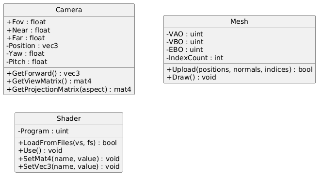
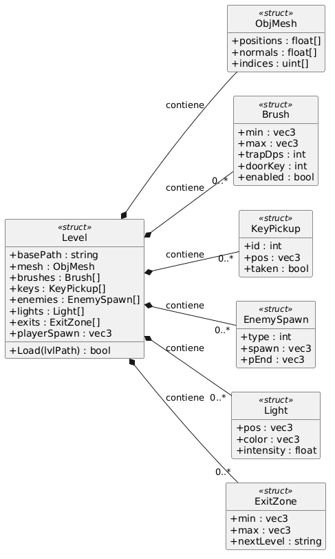
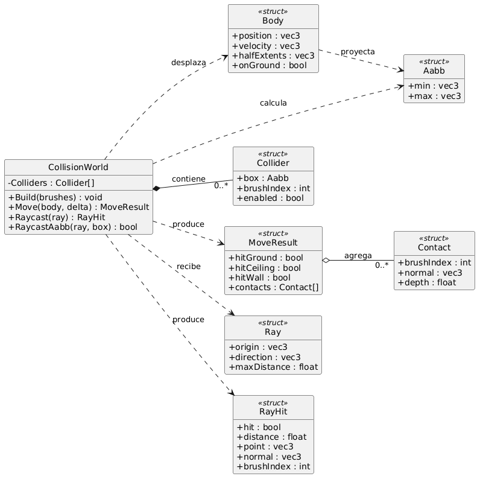
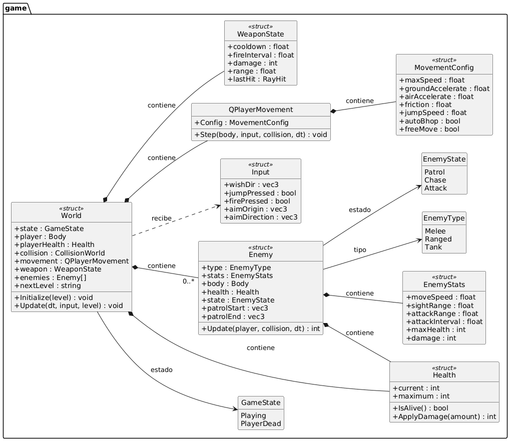
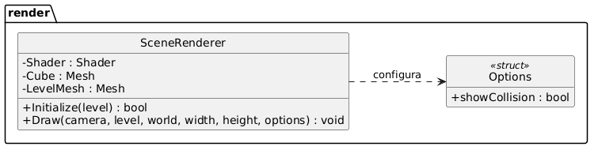
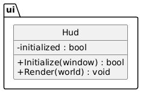

# Arena FPS

First-person arena FPS built on OpenGL 3.3 core.

## Stack

| Area | Library |
|---|---|
| Window / input | GLFW 3.4 |
| OpenGL | 3.3 core |
| GL function loading | GLAD |
| Math | GLM 1.0.1 |
| `.obj` geometry | tinyobjloader 1.0.6 |
| Build | CMake ≥ 3.16, C++20 |

## Requirements

- A C++20 compiler.
- CMake ≥ 3.16.
- OpenGL and GLFW 3.3+ installed on the system.

On Debian/Ubuntu:

```bash
sudo apt install cmake g++ libglfw3-dev
```

GLM, GLAD and tinyobjloader are vendored in `src/third_party/`, so they do not
need to be installed or downloaded.

## Build and run

```bash
cmake -S src -B build
cmake --build build -j
./build/arena
```

## Controls

| Action | Input |
|---|---|
| Look | Mouse |
| Move | `WASD` |
| Jump | `Space` |
| Fire hitscan | Left click (cursor captured) |
| Toggle auto-bhop / normal jump | `F2` |
| Toggle free movement (no physics) | `F3` |
| Free move up / down | `Space` / `Left Ctrl` |
| Collision debug | `F1` |
| Release the cursor | `Esc` |
| Recapture the cursor | Left click (cursor released) |
| Restart after death | `R` |

Projectiles, traps and enemy variety are added in the following milestones.

## Structure

```
src/
  main.cpp        Startup, window, GL context and loop
  gl/             Shader, mesh (VAO/VBO/EBO) and camera
  physics/        Collision world and raycasts
  game/           Player, weapons, enemies and rules
  level/          OBJ loading with tinyobjloader and the layer that defines the level
  ui/             Dear ImGui integration
  third_party/    Vendored GLM, GLAD and tinyobjloader
levels/           Geometry and metadata for the levels
```

## Class diagrams

### gl



Source: [`diagrams/gl.puml`](diagrams/gl.puml)

### level



Source: [`diagrams/level.puml`](diagrams/level.puml)

### physics



Source: [`diagrams/physics.puml`](diagrams/physics.puml)

### game



Source: [`diagrams/game.puml`](diagrams/game.puml)

### render



Source: [`diagrams/render.puml`](diagrams/render.puml)

### ui



Source: [`diagrams/ui.puml`](diagrams/ui.puml)

## External / vendored dependencies

See `src/third_party/README.md` for the origin, version and license of each
dependency.
